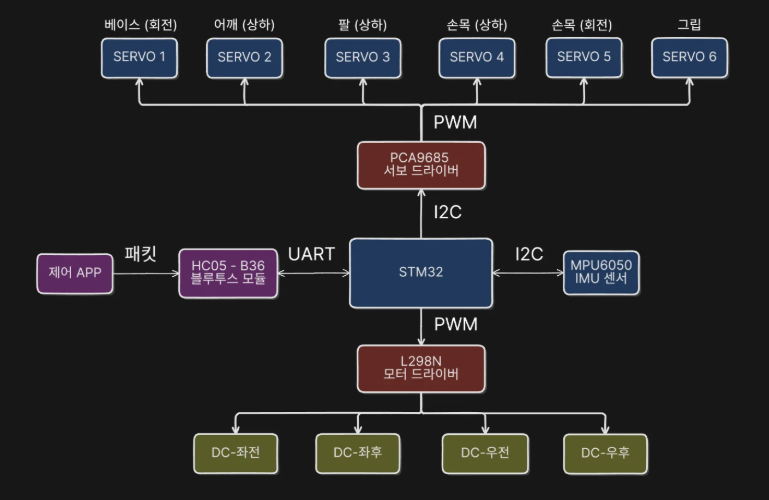
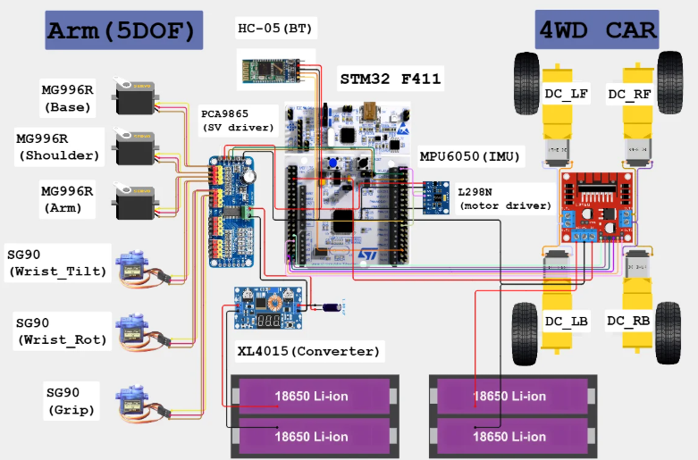
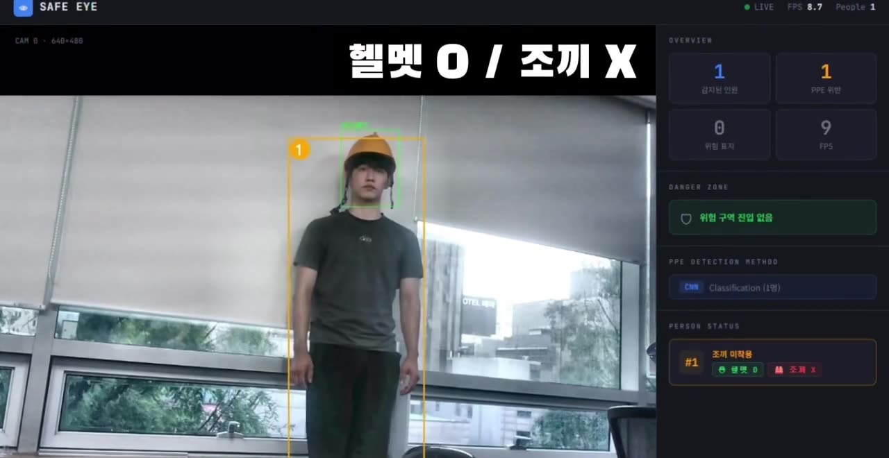
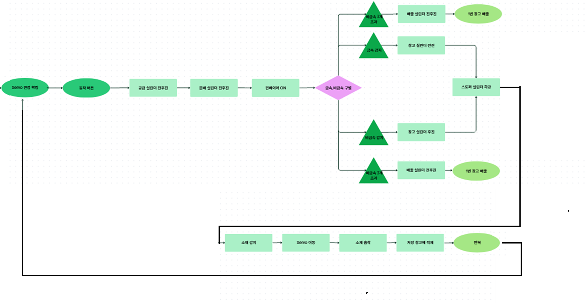
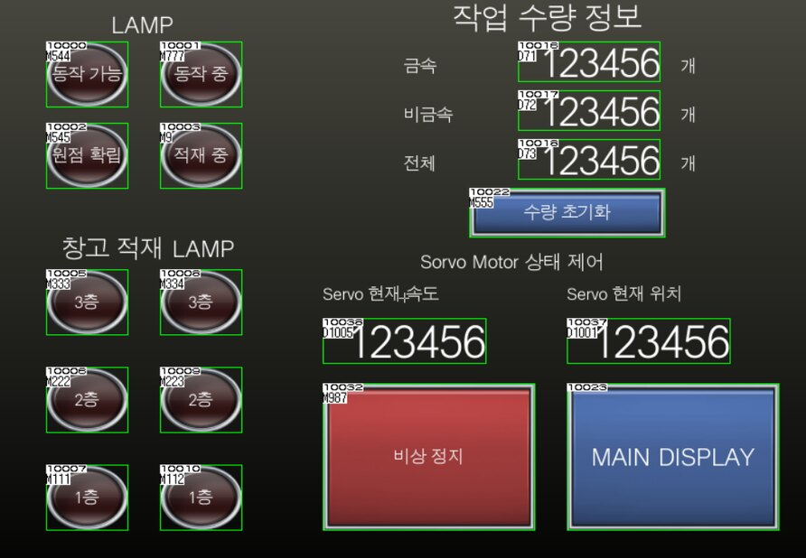

# 채윤식 · Embedded & Industrial Automation Portfolio

회로 설계와 배선부터 STM32 펌웨어, ROS 2 로봇 제어, PLC 자동화까지 —
신호가 흐르는 전 구간을 직접 다루는 엔지니어를 목표로 합니다.

**🔗 포트폴리오 사이트 · 시연 영상: https://micoleb3.github.io**

`ROS 2` `Nav2` `OpenCV` `ArUco` `STM32` `C` `HAL` `Python` `YOLO11` `MobileNetV3` `Mitsubishi PLC` `GX Works2` `GT Designer3`

---

## Projects

| | 프로젝트 | 핵심 | 내 역할 | 코드 |
|---|---|---|---|---|
| 01 | **ManyFarm** — 스마트팜 다중 로봇 (진행 중) | 운송로봇 Nav2 주행 + ArUco·LiDAR 정밀 도킹 | 운송로봇 파트 전담 | — |
| 02 | **ChaPaRi** — 모바일 물품 회수 로봇 | STM32 4WD 차량 + 5축 로봇팔 | 주행·서보 제어, 하드웨어·전원 설계 | [mobile-retrieval-robot](https://github.com/micoleb3/mobile-retrieval-robot) |
| 03 | **Safe Eye** — On-Device AI 안전 감지 | Raspberry Pi 5 PPE·위험구역 실시간 감지 | PPE MLC 모델, 위험구역 감지 | [safe-eye](https://github.com/micoleb3/safe-eye) |
| 04 | **PLC 분류 적재·배출 자동화** | 금속/비금속 판별 → 층별 적재 → 배출 | 래더, 서보 위치결정, HMI, 안전 설계 | [plc-sorting-automation](https://github.com/micoleb3/plc-sorting-automation) |

---

### 01 · ManyFarm — 스마트팜 다중 로봇 · 운송로봇 주행 · 정밀 도킹 `진행 중`

> 7인 팀 · KDT 로봇 3기 최종 프로젝트 · 2026.09 ~ · ROS 2 Jazzy · Nav2 · TurtleBot3 Waffle Pi

예찰 → 수확 → 운송 → 선별로 이어지는 스마트팜 다중 로봇 시스템에서,
수확로봇에게 파프리카 바구니를 받아 선별장까지 옮기는 **운송로봇 파트를 전담**하고 있습니다.

- **정밀 도킹 노드 `dock.py`** — `FACE → SEARCH → TRACK → FINE → ALIGN → PUSH → DONE`
  - 두 로봇이 각자 지도 좌표로 마주 서면 오차가 합산(±2 cm → ±4 cm) → 정지한 수확로봇 차체의 ArUco 마커를 기준으로 상대 위치를 맞추는 구조
  - 큰 마커로 방향, 작은 마커로 정지 기준, 마지막은 LiDAR 직선 정렬
  - 장소 값을 `sites.yaml`로 분리해 주차장·수확로봇·선별장을 같은 코드로 처리
- **미션 FSM** — 정상 9개 State + 전역 ERROR/ESTOP, Nav2와 정밀 제어기의 제어권 단일화, `task_id`·`transfer_id`로 인계 이벤트 중복 방지
- **배포** — `install.sh` 한 번으로 팀원 PC 설치(빌드·DDS·SSH 키, 멱등 실행), 조작은 짧은 CLI로 통일
- **기구·전장** — 300×300×190 mm 적재 바구니 설계·제작, 틸트 하중 계산으로 웜기어 모터 선정, 3S LiPo 전원 분기·퓨즈 설계

**트러블슈팅** — 멀티캐스트 차단으로 DDS 탐색 실패 → 유니캐스트 전환 · Pi 4 과부하 → 카메라·RANSAC을 필요한 순간에만 실행 · TF 시간 불일치 → 기동 시 시계 동기화

---

### 02 · ChaPaRi — 모바일 물품 회수 로봇

> 5인 팀 · STM32F411 · C · HAL · L298N · PCA9685

 

- **주행** — L298N으로 DC모터 4개 차동 구동, TIM2 20 kHz PWM + 방향 GPIO
- **로봇팔** — PCA9685(I2C) 6채널 50 Hz PWM으로 MG996R·SG90 서보 6개 각도 제어
- **하드웨어** — 서보·차량 2S 배터리 전원 분리, XL4015 강압, 1000 µF 안정화, 공통 GND, STM32 핀 배치
- **트러블슈팅** — 서보 부하 시 떨림 → 순간 전압 강하가 원인, 커패시터 적용·전원 배선 점검으로 해결

---

### 03 · Safe Eye — On-Device AI 산업 현장 안전 감지

> 4인 팀 · Raspberry Pi 5 · YOLO11 · MobileNetV3 · Python



- **PPE 멀티라벨 분류** — person 크롭을 MobileNetV3Large(헬멧·조끼 Sigmoid×2)로 분류, 클래스 불균형을 균등 샘플링 + Stratified 3분할로 해결
- **위험구역 감지** — YOLO11n 표지판 탐지 → Danger Zone polygon → 발 위치가 들어오면 즉시 경고
- **결과** — 정확도 헬멧 91.0% · 조끼 91.8%, 위험구역 Precision 1.000 · Recall 0.940

---

### 04 · PLC 금속·비금속 분류 적재·배출 자동화

> Mitsubishi Q03UDV · QD77MS2 · GX Works2 · GT Designer3 (GOT2000)

 

- **모션** — QD77MS2 서보 위치결정으로 층별 적재·흡착 위치 제어 (INCP 상대 위치결정)
- **HMI** — 동작 상태·적재 현황 램프, 원점복귀·JOG·배출·비상정지 조작
- **안전** — 자기유지를 끊어 즉시 정지시키는 비상정지 설계
- **트러블슈팅** — 배출 시 INCP 중복 실행 → 초기화 조건에 동작완료 b접점 추가

---

## About

- **교육** — 대한상공회의소 서울기술교육센터 AI융합 로봇SW개발자 과정 (2026.04 ~ 2026.11 수료 예정)
- **경력** — 대한민국 육군 부사관 약 8년 (중사 전역) · 박격포분대장 · 특공여단 지원조장
- **연락** — micoleb3@gmail.com

<details>
<summary>이 저장소 구조 · 로컬 실행</summary>

```text
docs/            GitHub Pages 사이트 (index.html · style.css · themes.css · app.js)
docs/assets/     프로젝트 이미지 · 영상 · 발표자료 PDF
docs/preview.py  로컬 프리뷰 서버
```

```bash
cd docs && python3 preview.py
# http://127.0.0.1:4174/
```

</details>
